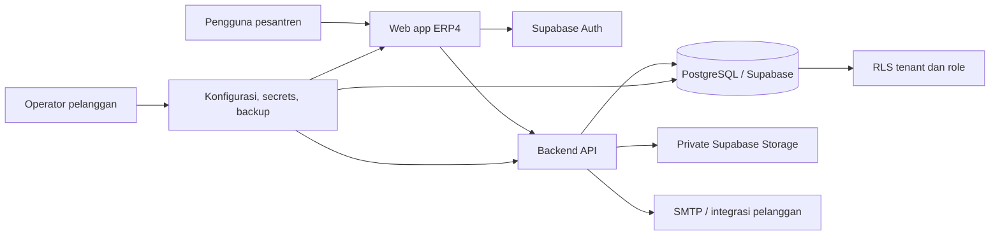

# Arsitektur Solusi ERP4 Pesantren

**Status dokumen:** arsitektur tujuan untuk produk customer-managed, bukan pernyataan bahwa migrasi sudah selesai.  
**Kebijakan produk:** pelanggan mengoperasikan instalasinya sendiri. ERP4 Pesantren tidak bergantung pada platform SaaS bersama milik vendor.

## Komponen target

- **Web app:** frontend ERP4 Pesantren, disajikan oleh paket rilis pelanggan.
- **Backend API:** memegang secret server, validasi otorisasi dan operasi sensitif. Secret service-role tidak boleh dikirim ke browser.
- **Supabase Auth:** autentikasi pengguna; profil dan role dikelola dengan kontrol server dan RLS.
- **PostgreSQL + RLS:** sumber data operasional canonical. Setiap record tenant-scoped yang relevan memiliki tenant ID. Kebijakan juga memeriksa role dan relasi pengguna.
- **Supabase Storage:** berkas privat dengan metadata tenant dan otorisasi yang sesuai.
- **Integrasi eksternal:** SMTP, payment gateway, dan layanan lain dikonfigurasi oleh pelanggan, bersifat opsional, serta harus memiliki mode gagal yang aman.
- **Operator pelanggan:** mengendalikan domain, infrastruktur, backup, pengguna Admin awal, rotasi kunci, dan waktu upgrade.

## Isolasi dan deployment pelanggan

Setiap instalasi berada pada akun cloud atau server pelanggan. Pelanggan dapat memilih proyek Supabase terkelola yang dimiliki sendiri atau stack Supabase self-hosted. Satu instalasi dapat mengelola satu pesantren atau beberapa kampus dalam organisasi pelanggan; RLS tetap membatasi tenant meskipun database sudah didedikasikan untuk pelanggan.

Tidak ada database atau storage bersama yang dijalankan vendor untuk seluruh pelanggan. Bantuan operasional vendor tidak membutuhkan akses permanen ke data pelanggan.

## Batas kompatibilitas

Supabase adalah backend yang ditargetkan, termasuk PostgreSQL, Auth, RLS, dan Storage. Mendukung Supabase terkelola dan Supabase self-hosted tidak otomatis berarti mendukung PostgreSQL biasa atau provider Auth/Storage lain. Provider baru hanya didukung setelah adapter dan acceptance test ditambahkan.

Profil deployment, tahap dukungan, dan latihan pemulihan dijelaskan pada [Kontrak Portabilitas Deployment](DEPLOYMENT_PORTABILITY.md).

## Status implementasi

Kode saat ini masih dalam cutover dari Firebase. Beberapa modul, autentikasi, serta proses admin/legacy masih memakai Firebase; keberadaan jalur PPDB dan beberapa jalur backend Supabase tidak berarti seluruh produk sudah berpindah. Jangan gunakan diagram target ini sebagai checklist bahwa deployment sudah dapat digunakan.

Lihat [Status Cutover Supabase](SUPABASE_CUTOVER_STATUS.md) untuk daftar modul, dependensi Firebase yang tersisa, urutan cutover, dan release gate. Sebelum penerapan ke data pelanggan, setiap modul harus memiliki satu sumber tulis yang konsisten, tenant/RLS diverifikasi, serta prosedur migrasi dan pemulihan data yang dibuktikan.
