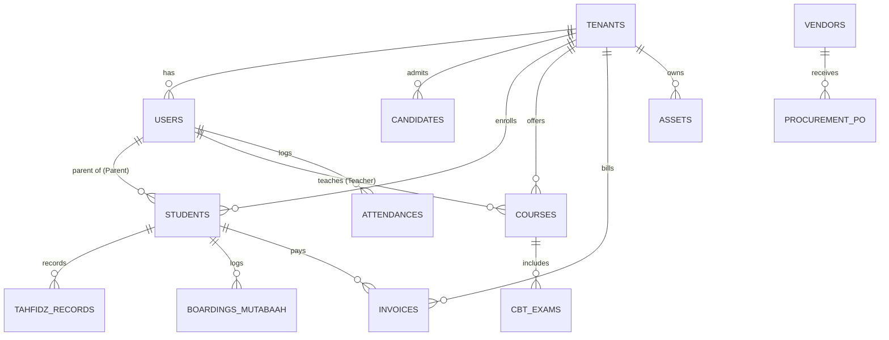

# Entity Relationship Diagram (ERD) & Database Structure — Model Legacy Firestore

**Status:** dokumen ini mendeskripsikan model Firebase/Firestore lama, bukan skema target Supabase. ERP4 Pesantren diarahkan sebagai software self-hosted milik pelanggan, bukan SaaS yang dioperasikan vendor. Asumsi rilis awal adalah satu installation per pesantren. Field `tenantId` tetap dipakai sebagai batas data dalam installation dan untuk kompatibilitas migrasi; field ini bukan bukti bahwa data pelanggan akan digabung dalam database vendor.

## 1. Domain: Access & Master Data

### `tenants` (Yayasan/Pesantren)
Menyimpan konfigurasi utama untuk institusi.
- `id` (PK)
- `name` (String)
- `domain` (String)
- `settings` (Map) -> Logo, brand, dll.

### `users` (Akun Login & RBAC)
Sinkronisasi dengan Firebase Authentication.
- `uid` (PK, Auth ID)
- `tenantId` (FK -> tenants.id)
- `role` (String) -> 'ADMIN', 'TEACHER', 'MUSYRIF', 'PARENT', 'EXECUTIVE'
- `email` (String)
- `profileData` (Map)

---

## 2. Domain: PPDB & Students

### `candidates` (Calon Santri / PPDB)
Pipeline penerimaan siswa baru.
- `id` (PK)
- `tenantId` (FK)
- `registrationSequence` (String)
- `name`, `nik`, `dob`, `address` (Strings)
- `documents` (Map) -> Checklist dokumen
- `stage` (String) -> 'Registered', 'Entry Exam', 'Interview', 'Accepted', 'Rejected'
- `score` (Number)

### `students` (Santri Aktif)
- `id` (PK)
- `tenantId` (FK)
- `nis` / `nisn` (String)
- `name` (String)
- `currentDormId` (FK -> dorms.id)
- `currentClassId` (FK -> classes.id)
- `parentId` (FK -> users.uid) -> Relasi Parents Dashboard

---

## 3. Domain: Academic, LMS & Tahfidz

### `courses` (Modul LMS)
- `id` (PK)
- `tenantId` (FK)
- `title` (String)
- `instructorId` (FK -> users.uid)
- `syllabus` (Array)

### `cbt_exams` (Ujian CBT)
- `id` (PK)
- `tenantId` (FK)
- `courseId` (FK -> courses.id)
- `title` (String)
- `dateTime` (Timestamp)
- `status` (String) -> 'Draft', 'Active', 'Done'

### `tahfidz_records` (Log Hafalan)
- `id` (PK)
- `tenantId` (FK)
- `studentId` (FK -> students.id)
- `musyrifId` (FK -> users.uid)
- `surahStart`, `ayatStart`, `surahEnd`, `ayatEnd` 
- `grade` (String) -> 'Mumtaz', 'Jayyid', dll
- `date` (Timestamp)

---

## 4. Domain: Boarding & Operations

### `boardings_mutabaah` (Aktivitas Asrama)
- `id` (PK)
- `tenantId` (FK)
- `studentId` (FK -> students.id)
- `dhuha`, `tahajud`, `tilawah`, `jamaah` (Boolean)
- `date` (Timestamp)

### `assets` (Inventory & Asset Management)
- `id` (PK)
- `tenantId` (FK)
- `itemName` (String)
- `qrCode` (String)
- `status` (String) -> 'Active', 'Maintenance', 'Disposed'
- `location` (String)

### `procurement_po` (Purchase Orders)
- `id` (PK)
- `tenantId` (FK)
- `vendorId` (FK -> vendors.id)
- `items` (Array of Map)
- `status` (String) -> 'Draft', 'Issued', 'Fulfilled'

---

## 5. Domain: HRIS & E-Office

### `attendances` (Absensi Pegawai)
- `id` (PK)
- `tenantId` (FK)
- `userId` (FK -> users.uid)
- `clockIn`, `clockOut` (Timestamps)
- `geolocation` (Map) -> `lat`, `lng`
- `status` (String) -> 'On Time', 'Late'

### `documents_office` (E-Office & Arsip)
- `id` (PK)
- `tenantId` (FK)
- `type` (String) -> 'Surat Masuk', 'Surat Keluar', 'MOU'
- `title` (String)
- `status` (String) -> 'Draft', 'Waiting Approval', 'Approved', 'Disposed'
- `fileUrl` (String)

---

## 6. Domain: Finance, E-Commerce & Ecosystem

### `invoices` (Keuangan Billing)
- `id` (PK)
- `tenantId` (FK)
- `studentId` (FK -> students.id)
- `title` (String)
- `amount` (Number)
- `dueDate` (Timestamp)
- `status` (String) -> 'UNPAID', 'PARTIAL', 'PAID'

### `marketplace_orders` (E-Commerce)
- `id` (PK)
- `tenantId` (FK)
- `buyerId` (FK -> users.uid)
- `items` (Array of Map)
- `total` (Number)
- `status` (String) -> 'Pending', 'Processing', 'Delivered'

### `ecosystem_transactions` (PPOB & Ziswaf)
- `id` (PK)
- `tenantId` (FK)
- `transactionType` (String) -> 'PPOB', 'ZISWAF', 'SAVINGS'
- `amount` (Number)
- `timestamp` (Timestamp)
- `status` (String) -> 'Success', 'Failed'

---

## ERD Diagram (Mermaid)

## Indexing Strategy
Kompleksitas laporan eksekutif dan analitik membutuhkan _Composite Indexes_ Firestore.
Beberapa index kritikal yang diamankan:
1. `invoices`: `tenantId` ASC, `status` ASC, `dueDate` DESC.
2. `tahfidz_records`: `tenantId` ASC, `studentId` ASC, `date` DESC.
3. `marketplace_orders`: `tenantId` ASC, `status` ASC, `timestamp` DESC.
4. `attendances`: `tenantId` ASC, `userId` ASC, `clockIn` DESC.
