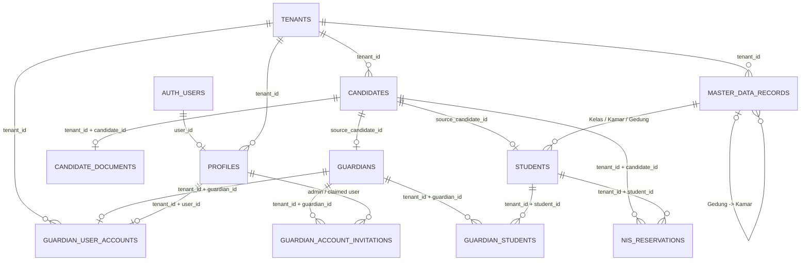
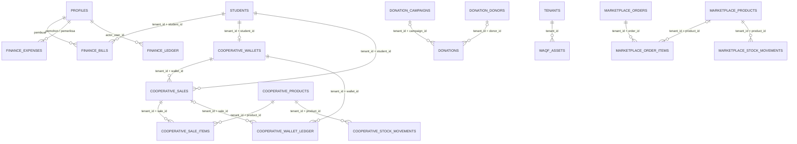
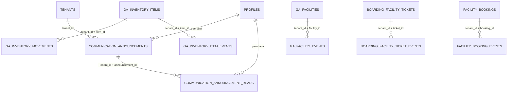

# ERD Target Supabase ERP4 Pesantren

## Status dan sumber kebenaran

Dokumen ini menjelaskan **target relasional Supabase/PostgreSQL**, sebagai pendamping [ERD Firestore legacy](ERD.md). ERD legacy tetap berguna untuk memahami arsip sumber, tetapi bukan skema runtime target.

Sumber skema adalah berkas SQL di `supabase/migrations/` pada checkout ini. ERD ini merangkum relasi utama; definisi kolom, constraint, fungsi, trigger, indeks, RLS, dan grants tetap mengikuti migrasi SQL.

> **Batas versi:** checkout berada pada commit PR #13 `8d9dc4c3555b69b223aa9f36c78c2e7e4cf7858b`. Worktree ini juga memuat tiga migrasi Wali yang belum di-commit/masuk ke head remote PR #13: `20270102000000_guardian_accounts_and_invitations.sql`, `20270103000000_guardian_finance_access.sql`, dan `20270104000000_guardian_boarding_access.sql`. Diagram menampilkan skema worktree saat ini. Migrasi tersebut belum diterapkan ke Supabase Production.

## Prinsip model data

- `auth.users` adalah identitas login yang dikelola Supabase. `public.profiles.user_id` mengacu ke `auth.users.id`; profil aplikasi dan tenant berada di `public.profiles`.
- `public.tenants` adalah akar ruang data. Tabel operasional memakai `tenant_id`; relasi antardata dalam tenant menggunakan foreign key komposit yang menyertakan `tenant_id` bila skema menyediakan constraint tersebut.
- Tenant ID tetap diperlukan untuk isolasi internal, walaupun pola distribusi produk adalah instalasi milik masing-masing pesantren.
- Akses tidak dijamin oleh diagram saja. RLS, grants, pemeriksaan role/tenant di RPC/API, dan konfigurasi trusted server pada migrasi tetap menjadi bagian kontrak keamanan.
- `public.user_profiles` dibuat oleh migrasi transisi `20261022000000_user_profiles.sql`. Header migrasi berikutnya menyebut runtime memakai `public.profiles`; jangan menjadikan `user_profiles` target integrasi baru sebelum ada keputusan migrasi/penghapusan eksplisit.
- Data NIK/NISN santri disimpan sebagai ciphertext dan fingerprint pada `students`; gunakan API detail berizin, bukan menambahkannya ke snapshot/list umum.
- File bukti pembayaran berada di Supabase Storage. `proof_storage_path` pada tagihan adalah referensi objek, bukan foreign key ke tabel PostgreSQL.
- Ledger Finance memakai pasangan `source_type` + `source_id` yang bersifat polimorfik; relasi ke tagihan/pengeluaran dijaga oleh aturan transaksi, bukan satu foreign key SQL.
- Tabel bertipe `*_events`, `*_import_batches`, `*_write_requests`, dan `*_mutation_requests` mendukung audit, migrasi, atau idempotensi. Tabel tersebut bukan pengganti record bisnis utama.

## ERD inti: tenant, identitas, PPDB, dan Master Data

`master_data_records` menyimpan kategori terkontrol seperti Gedung, Kamar, dan Kelas. Relasi orang tua pada struktur memakai `parent_id` dan kategori orang tua; santri mengacu pada record struktur dengan `tenant_id` serta kategori yang sesuai. `nis_reservations` menjadi pengunci NIS tenant-scoped untuk mencegah pemakaian ganda saat onboarding atau impor.

Relasi Wali bersifat banyak-ke-banyak pada `guardian_students`, sehingga satu akun Wali dapat terhubung dengan beberapa santri. `guardian_user_accounts` menghubungkan satu profil Wali dengan satu record Wali per tenant; undangan disimpan dalam bentuk hash token, memiliki masa berlaku, dan diklaim menggunakan profil Auth yang telah diverifikasi. Pastikan tiga migrasi Wali pada catatan batas versi di atas ditinjau dan diuji sebelum memasukkannya ke PR.

## ERD Tahfidz dan Akademik

```mermaid
erDiagram
    TENANTS ||--o{ TAHFIDZ_HALAQAHS : "tenant_id"
    PROFILES ||--o{ TAHFIDZ_HALAQAHS : "ustadz"
    TAHFIDZ_HALAQAHS ||--o{ TAHFIDZ_MEMBERSHIPS : "tenant_id + halaqah_id"
    STUDENTS ||--o{ TAHFIDZ_MEMBERSHIPS : "tenant_id + student_id"
    STUDENTS ||--o{ TAHFIDZ_RECORDS : "tenant_id + student_id"
    TAHFIDZ_HALAQAHS ||--o{ TAHFIDZ_RECORDS : "tenant_id + halaqah_id"
    PROFILES ||--o{ TAHFIDZ_RECORDS : "pencatat"
    STUDENTS ||--o{ TAHFIDZ_TARGETS : "tenant_id + student_id"
    PROFILES ||--o{ TAHFIDZ_TARGETS : "ustadz"
    STUDENTS ||--o{ TAHFIDZ_SESSIONS : "tenant_id + student_id"
    TAHFIDZ_HALAQAHS ||--o{ TAHFIDZ_SESSIONS : "tenant_id + halaqah_id"
    PROFILES ||--o{ TAHFIDZ_SESSIONS : "penguji / pembuat"
    PROFILES ||--o{ ACADEMIC_RECORDS : "ustadz / pembuat"
    STUDENTS o|--o{ ACADEMIC_RECORDS : "assessment only"
    TENANTS ||--o{ ACADEMIC_RECORDS : "tenant_id"
    CBT_EXAMS ||--o{ CBT_EXAM_QUESTIONS : "tenant_id + exam_id"
    CBT_QUESTIONS ||--o{ CBT_EXAM_QUESTIONS : "tenant_id + question_id"
    CBT_EXAMS ||--o{ CBT_EXAM_ASSIGNMENTS : "tenant_id + exam_id"
    STUDENTS ||--o{ CBT_EXAM_ASSIGNMENTS : "tenant_id + student_id"
    CBT_EXAMS ||--o{ CBT_ATTEMPTS : "tenant_id + exam_id"
    STUDENTS ||--o{ CBT_ATTEMPTS : "tenant_id + student_id"
    LMS_COURSES ||--o{ LMS_COURSE_MODULES : "tenant_id + course_id"
    LMS_COURSE_MODULES ||--o{ LMS_MATERIALS : "tenant_id + module_id"
    LMS_COURSES ||--o{ LMS_ENROLLMENTS : "tenant_id + course_id"
    STUDENTS ||--o{ LMS_ENROLLMENTS : "tenant_id + student_id"
    LMS_COURSES ||--o{ LMS_ASSIGNMENTS : "tenant_id + course_id"
    LMS_ASSIGNMENTS ||--o{ LMS_SUBMISSIONS : "tenant_id + assignment_id"
    STUDENTS ||--o{ LMS_SUBMISSIONS : "tenant_id + student_id"
    LMS_MATERIALS ||--o{ LMS_MATERIAL_PROGRESS : "tenant_id + material_id"
    STUDENTS ||--o{ LMS_MATERIAL_PROGRESS : "tenant_id + student_id"
```

Akademik menggunakan `academic_records` dengan tipe record terkontrol dan payload domain pada JSONB. CBT memisahkan bank soal, ujian, relasi soal-ujian, penugasan santri, dan percobaan/jawaban. LMS memisahkan katalog, materi, enrollment, tugas, kiriman, progres, catatan, dan komentar. Rincian payload dan validasi tetap harus mengikuti migrasi tiap domain.

## ERD asrama dan layanan santri

```mermaid
erDiagram
    STUDENTS ||--o{ BOARDING_PERMITS : "tenant_id + student_id"
    BOARDING_PERMITS ||--o{ BOARDING_PERMIT_EVENTS : "tenant_id + permit_id"
    STUDENTS ||--o{ BOARDING_DISCIPLINE_INCIDENTS : "tenant_id + student_id"
    BOARDING_DISCIPLINE_INCIDENTS ||--o{ BOARDING_DISCIPLINE_EVENTS : "tenant_id + incident_id"
    BOARDING_ATTENDANCE_SESSIONS ||--o{ BOARDING_ATTENDANCE_RECORDS : "tenant_id + session_id"
    STUDENTS ||--o{ BOARDING_ATTENDANCE_RECORDS : "tenant_id + student_id"
    BOARDING_ATTENDANCE_RECORDS ||--o{ BOARDING_ATTENDANCE_EVENTS : "tenant_id + record_id"
    PROFILES ||--o{ BOARDING_STAFF_ASSIGNMENTS : "petugas"
    MASTER_DATA_RECORDS ||--o{ BOARDING_STAFF_ASSIGNMENTS : "unit / kamar"
    STUDENTS ||--o| HEALTHCARE_RECORDS : "tenant_id + student_id"
    STUDENTS ||--o{ HEALTHCARE_VISITS : "tenant_id + student_id"
    STUDENTS ||--o{ LAUNDRY_ORDERS : "tenant_id + student_id"
    LAUNDRY_ORDERS ||--o{ LAUNDRY_EVENTS : "tenant_id + order_id"
    LIBRARY_BOOKS ||--o{ LIBRARY_CIRCULATIONS : "tenant_id + book_id"
    STUDENTS ||--o{ LIBRARY_CIRCULATIONS : "tenant_id + student_id"
    HRIS_EMPLOYEES ||--o{ HRIS_ATTENDANCE : "tenant_id + employee_id"
    HRIS_EMPLOYEES ||--o{ HRIS_LEAVE_REQUESTS : "tenant_id + employee_id"
```

Event tables menyimpan jejak perubahan/aktor untuk proses tertentu. Penempatan kamar santri dan pilihan struktur tidak boleh ditafsirkan sebagai histori penempatan lengkap kecuali tabel/event yang sesuai memang digunakan oleh API terkait.

## ERD Finance, Koperasi, dan transaksi

`donation_audit_events.entity_type` + `entity_id` adalah relasi polimorfik tanpa foreign key ke kampanye, donor, donasi, atau aset wakaf.

`finance_ledger` dan `cooperative_wallet_ledger` adalah catatan transaksi/ledger; perubahan saldo dan status sebaiknya dilakukan melalui RPC/API transaksional yang disediakan, bukan manipulasi langsung record ledger dari klien.

## ERD komunikasi, aset, dan fasilitas

## Katalog tabel pada checkout

Daftar berikut adalah katalog nama tabel yang ditemukan pada `CREATE TABLE public.*` di migrasi checkout ini. Tabel pendukung untuk audit, impor, dan retry sengaja tetap dicantumkan agar tidak terlewat saat meninjau dependensi.

- **Akses, tenant, dan komunikasi:** `tenants`, `profiles`, `user_profiles`, `tenant_settings`, `identity_claims`, `public_rate_limits`, `search_feedback`, `communication_announcements`, `communication_announcement_reads`, `communication_announcement_import_state`.
- **PPDB, identitas calon, dan Master Data:** `candidates`, `candidate_documents`, `ppdb_candidate_admin_events`, `ppdb_legacy_import_batches`, `ppdb_onboarding_events`, `registration_counters`, `nis_reservations`, `master_data_records`, `students`, `guardians`, `guardian_students`, `guardian_user_accounts`, `guardian_account_invitations`.
- **Akademik dan CBT:** `academic_records`, `academic_import_runs`, `cbt_exams`, `cbt_questions`, `cbt_exam_questions`, `cbt_exam_assignments`, `cbt_attempts`, `cbt_legacy_import_batches`.
- **Tahfidz:** `tahfidz_halaqahs`, `tahfidz_memberships`, `tahfidz_records`, `tahfidz_targets`, `tahfidz_sessions`, `tahfidz_target_write_requests`, `tahfidz_halaqah_write_requests`, `tahfidz_membership_write_requests`, `tahfidz_session_write_requests`.
- **LMS:** `lms_categories`, `lms_courses`, `lms_course_modules`, `lms_materials`, `lms_enrollments`, `lms_assignments`, `lms_submissions`, `lms_material_progress`, `lms_student_notes`, `lms_material_comments`, `lms_submission_requests`, `lms_submission_grade_events`, `lms_learning_record_requests`, `lms_legacy_import_batches`.
- **Asrama:** `boarding_permits`, `boarding_permit_events`, `boarding_permit_import_batches`, `boarding_discipline_incidents`, `boarding_discipline_events`, `boarding_discipline_import_batches`, `boarding_attendance_sessions`, `boarding_attendance_records`, `boarding_attendance_events`, `boarding_attendance_import_batches`, `boarding_staff_assignments`, `boarding_staff_assignment_events`, `boarding_cleanliness_audits`, `boarding_cleanliness_audit_events`, `boarding_facility_tickets`, `boarding_facility_ticket_events`.
- **Finance:** `finance_bills`, `finance_expenses`, `finance_ledger`, `finance_controls`, `finance_write_requests`.
- **Koperasi:** `cooperative_products`, `cooperative_suppliers`, `cooperative_wallets`, `cooperative_wallet_policy_events`, `cooperative_sales`, `cooperative_sale_items`, `cooperative_wallet_ledger`, `cooperative_stock_movements`, `cooperative_supplier_mutation_requests`, `cooperative_financial_import_batches`, `cooperative_financial_import_records`.
- **Perpustakaan:** `library_books`, `library_circulations`, `library_write_requests`, `library_book_import_batches`, `library_circulation_import_batches`.
- **HRIS:** `hris_employees`, `hris_employee_events`, `hris_attendance`, `hris_attendance_events`, `hris_leave_requests`, `hris_leave_events`, `hris_employee_import_batches`, `alumni_profiles`, `alumni_graduation_requests`.
- **Kesehatan:** `healthcare_records`, `healthcare_record_events`, `healthcare_visits`, `healthcare_medicines`, `healthcare_stock_movements`, `healthcare_legacy_import_batches`.
- **Urusan umum dan aset:** `ga_facilities`, `ga_facility_events`, `ga_inventory_items`, `ga_inventory_movements`, `ga_inventory_item_events`, `ga_legacy_import_batches`.
- **Marketplace:** `marketplace_products`, `marketplace_orders`, `marketplace_order_items`, `marketplace_order_events`, `marketplace_stock_movements`, `marketplace_mutation_requests`, `marketplace_legacy_import_batches`.
- **Donasi, wakaf, fasilitas, dan laundry:** `donation_campaigns`, `donation_donors`, `donations`, `donation_audit_events`, `donation_receipt_counters`, `donation_mutation_requests`, `waqf_assets`, `facility_bookings`, `facility_booking_events`, `facility_booking_import_batches`, `laundry_settings`, `laundry_orders`, `laundry_events`, `laundry_mutation_requests`.

## Catatan untuk tim backend

1. Gunakan migrasi SQL sebagai sumber definisi kolom dan urutan upgrade; jangan membuat skema ulang hanya dari Mermaid.
2. Pertahankan `tenant_id` pada query, foreign key, unique constraint, RPC, dan RLS. Relasi komposit adalah kontrol integritas tambahan, bukan pengganti otorisasi.
3. Tinjau indeks untuk pola filter/urutan per tenant dan jalankan rencana query pada dataset realistis pesantren besar.
4. Jalankan semua migrasi berurutan pada Supabase lokal/CI dan staging kosong; cocokkan versi staging/Production sebelum apply.
5. Tambahkan target ERD ke kontrak review setiap perubahan migrasi. Revisi katalog dan diagram dalam perubahan yang sama bila entitas atau relasi berubah.
6. Daftar ini tidak menyatakan seluruh fitur sudah aktif, seluruh tabel sudah terpasang pada project Supabase live, atau data Firestore telah dimigrasikan.
