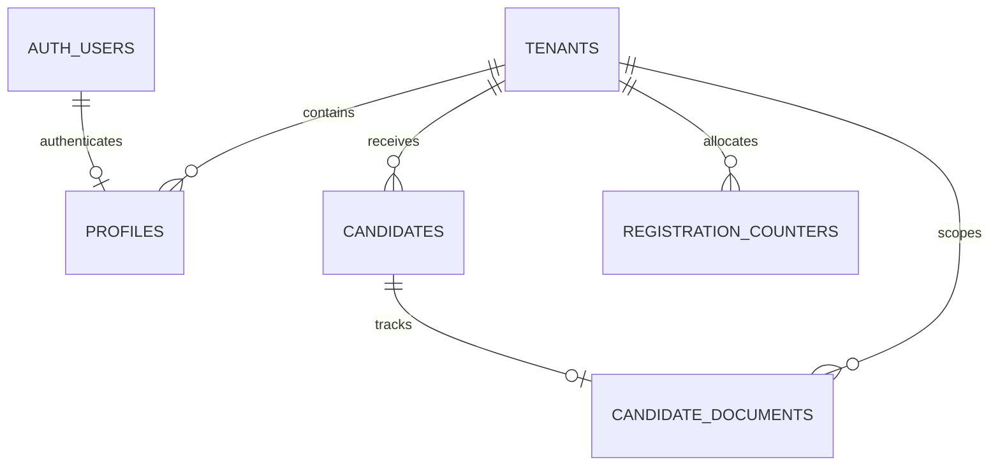

# Supabase Tenant Foundation

Status: prepared on `backend/supabase-tenant-foundation`; not applied to the Supabase database.

The Supabase GitHub integration is connected to `hamdanfaiz/ERP4-Pesantren` with working directory `.`. Production auto-deploy is disabled. The current Free plan does not provide preview database branches, so connecting the repository does not apply this feature branch's migration.

## Scope

This is the first migration slice for the Supabase project `vqemuyzveuirlkvdggjd`. The ERP frontend and its operational data are still Firebase-first. This migration creates a tenant-aware relational foundation for identity and PPDB; it does not migrate Firestore records, replace the frontend data layer, configure Storage, or make Supabase the production source of truth.

The prior initial migration was not recorded as applied in the Supabase dashboard when this work began. It has therefore been rewritten before first application to add tenant boundaries and RLS. Before applying it, verify again that there are no manually created tables or live rows that need preservation.

## Entity relationships

- `tenants`: institution boundary; canonical UUID plus unique lowercase slug.
- `profiles`: one active tenant and application role per Supabase Auth user. Role and module permissions are stored here, not in user-editable Auth metadata.
- `candidates`: PPDB records; registration number and keyed NIK/NISN fingerprints are unique within a tenant. NIK/NISN plaintext is not stored: the backend writes ciphertext plus a keyed fingerprint.
- `candidate_documents`: checklist row tied to the candidate and the same tenant through a composite foreign key.
- `registration_counters`: per-tenant/per-admission-year sequence state. Only trusted backend code may allocate or update it.

## Access contract

- RLS is enabled and forced on every application table in this migration.
- Tenant context comes from the active row in `profiles` for `auth.uid()`; a client-supplied `tenant_id` or Auth user metadata never establishes tenant access.
- A suspended profile or tenant has no active tenant context.
- Authenticated users can read their own profile. A tenant Admin/SuperAdmin with the `users` module permission can read profiles in that same tenant. Browser profile writes are denied, so role, status, tenant, and permissions must be changed by a trusted backend provisioning function.
- Only tenant Admin/SuperAdmin users with the `ppdb` module permission can read candidate and candidate-document rows. NIK/NISN columns contain ciphertext and keyed fingerprints; authorized decryption stays in trusted backend code.
- Authenticated clients receive read-only table grants for candidates and documents. Mutations, account provisioning, and sequence allocation are reserved for the trusted `service_role` backend.
- `anon` has no table grants or RLS policy. Public PPDB submission must use a rate-limited, validated, idempotent Edge Function; there is intentionally no public table insert or select.
- This first slice does not create public Storage buckets or Storage policies.

## Migration mapping

| Current Firebase concept | Supabase foundation |
| --- | --- |
| `tenants/{tenantId}` | `public.tenants` |
| `users/{uid}` profile | `public.profiles.user_id = auth.users.id` |
| `candidates/{candidateId}` | `public.candidates` |
| candidate document checklist | `public.candidate_documents` |
| PPDB registration reservation/counter | `public.registration_counters` plus tenant-scoped unique constraints |

The database UUID `tenants.id` will not equal an existing Firestore tenant string by assumption. Before importing any data, create and review an explicit old-tenant-ID to UUID mapping. Preserve source IDs in a migration ledger or source-ID columns in a later migration if traceability is required. Do not dual-write from Firebase and Supabase.

## Required backend work before enabling writes

1. Implement the Supabase Auth/profile bootstrap and trusted user-management Edge Functions. The initial Admin must be provisioned by a controlled one-time trusted operation.
2. Implement a server-side PPDB endpoint that validates input, rate-limits submissions, allocates registration IDs atomically, applies per-tenant NIK/NISN uniqueness, and never exposes a service-role key to the browser.
3. Add the frontend repository adapter and explicit field mapping from current Firebase values to SQL enums and UUIDs.
4. Implement and test backend envelope encryption and tenant-scoped keyed fingerprints for NIK/NISN. Keep encryption and HMAC keys out of the browser and repository. PostgreSQL RLS and provider-managed at-rest encryption are not field-level encryption.
5. Design private Storage buckets and tenant-aware Storage policies before migrating payment evidence or applicant documents.
6. Build a reviewed, repeatable import with dry-run counts, validation, reconciliation, rollback/restore, and an explicit cutover window.

## Apply procedure

1. Review this branch and verify the Supabase project is still empty and has no manually created production data.
2. Merge only after the migration SQL has been reviewed. Apply migrations through the linked repository/CLI; do not paste a service key into the repository or browser.
3. Confirm RLS policies and table privileges in a non-production/test project before exposing data.
4. Keep production auto-deploy disabled until the branch, policies, and migration pipeline have been approved and exercised.
5. Keep Firebase as the active source until the import and backend endpoints are complete; no frontend cutover is implied by this migration.
